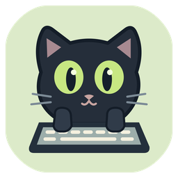
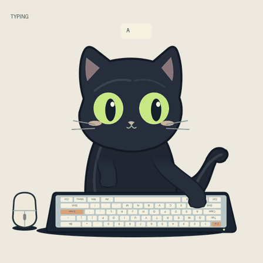

<p align="center">
  
</p>

<h1 align="center">BusyCat</h1>

<p align="center">陪你敲键盘的小黑猫 · A little black cat to keep you company</p>
<p align="center"><a href="#简体中文">简体中文</a> · <a href="#english">English</a> · <a href="LICENSE">MIT License</a></p>

<p align="center">
  
</p>
<p align="center">动画预览：打字 · 鼠标移动 · 空闲刷手机<br>Animation preview: typing · mouse movement · idle phone browsing</p>

## 简体中文

BusyCat 是一个用 Rust 编写的 Windows 桌面宠物。你打字时，小黑猫会伸爪敲击对应键位；你操作鼠标时，它也会跟着动。空闲一会儿，它就拿出手机，时不时露出小表情。

### 功能

- **全局键鼠响应**：在其他应用中打字、点击、滚动，也能触发猫咪动作和按键气泡。
- **按键定位**：猫爪根据键帽坐标移动，支持长按、快速点击和组合键；键位高亮与键盘素材使用同一份布局数据。
- **面对面的视角**：鼠标在画面左侧，键盘空格靠近猫身，键帽文字朝向猫咪；鼠标移动与用户方向相反，猫爪平滑跟随。
- **空闲刷手机**：默认 15 秒无操作后刷手机，随机出现偷笑、惊讶、嫌弃、困倦和害羞表情；有键鼠输入立即恢复。
- **持续摆尾**：尾根固定、尾尖轻摆，打字和刷手机时有不同的节奏。
- **独立设置窗口**：设置打开在猫咪旁边，支持简体中文 / English、尺寸滑块（125–800 px）、透明度和动作开关。默认尺寸为 250 px。
- **桌面常驻**：隐藏任务栏与 Alt+Tab 图标；Win+D 显示桌面后自动恢复置顶，不抢输入焦点，仍支持从托盘主动隐藏。
- **键鼠统计**：设置中查看本次运行的键盘按下、鼠标左 / 右 / 其他键点击和滚轮格数；支持清零，长按不重复计数，退出后清空。
- **系统托盘**：显示 / 隐藏猫咪、打开设置、切换鼠标穿透、按键气泡、空闲刷手机，以及退出。
- **透明置顶窗口**：可拖动摆放，F8 切换鼠标穿透。
- **原创素材**：SVG、透明 PNG 和多尺寸 ICO 均随源码提供，应用、窗口和托盘图标保持一致。

### 构建与运行

支持 Windows 10 / 11。安装 [Rust](https://www.rust-lang.org/tools/install) 稳定版（建议 1.90 或更高版本），以及 Visual Studio C++ Build Tools 和 Windows SDK，使用 MSVC 工具链。

```powershell
git clone git@github.com:AntNoHuabei/BusyCat.git
cd BusyCat
cargo run --release --locked
```

首次构建需要联网下载 crates.io 依赖。构建完成后的程序位于 `target/release/busycat.exe`；素材和图标已嵌入，可以单独复制 EXE 使用。中文显示使用 Windows 自带的微软雅黑。

### 使用方式

同一 Windows 登录会话只运行一个 BusyCat；重复启动会直接退出。程序退出或意外终止后可正常重新启动。

| 操作 | 效果 |
| --- | --- |
| 拖动猫咪 | 移动桌宠窗口 |
| 双击猫咪 / 右键 → 设置 | 打开独立设置窗口 |
| F8 | 切换鼠标穿透，再按一次恢复 |
| 右键托盘图标 | 打开托盘菜单 |
| 双击托盘图标 | 显示猫咪并打开设置 |
| 设置中的尺寸滑块 | 实时调整猫咪大小 |
| 托盘菜单 → 退出 BusyCat | 退出程序并移除托盘图标 |

如果托盘图标没有直接显示，请展开 Windows 托盘的隐藏图标区域。设置和托盘菜单的语言、勾选状态会同步。

```powershell
# 启动时直接打开设置
.\target\release\busycat.exe --settings

# 演示键盘和鼠标动作
.\target\release\busycat.exe --demo

# 检查全局键盘、鼠标钩子，不打开图形界面
.\target\release\busycat.exe --check-input
```

### 技术与项目结构

Rust + egui / eframe，显式使用 OpenGL / Glow 后端；不依赖 Vulkan、WebView、服务器或图片生成 API。Windows 全局键鼠钩子负责输入，`tray-icon` 提供托盘菜单，`winresource` 将图标嵌入 EXE。

| 路径 | 内容 |
| --- | --- |
| `src/main.rs` | 窗口、实时渲染与设置界面 |
| `src/input.rs` | Windows 全局键鼠监听 |
| `src/interaction.rs` | 输入状态、键位映射与动作选择 |
| `src/phone_expression.rs` | 刷手机时的随机表情 |
| `src/settings_ui.rs` | 语言与设置窗口布局 |
| `src/tray.rs` | 托盘菜单和事件 |
| `assets/cat/` | 猫咪素材、图集、独立鼠标 / 尾巴图层及键盘布局 |
| `assets/branding/` | Logo、应用图标和托盘图标 |
| `tools/` | 素材和 Logo 生成脚本 |
| `preview/` | 浏览器交互预览与素材预览 |
| `build.rs` | Windows 图标和程序信息资源 |

修改素材后可以重新生成：

```powershell
python -m pip install -r tools/requirements.txt
python tools/generate_assets.py
python tools/generate_phone_faces.py
python tools/generate_logo.py
cargo fmt
```

`preview/index.html` 可在浏览器中打开，但只能响应浏览器内的操作；原生 EXE 才支持全局输入。

### 检查

```powershell
cargo test --locked
cargo clippy --locked --all-targets -- -D warnings
cargo build --release --locked
.\target\release\busycat.exe --check-input
```

### 隐私与当前限制

输入事件仅用于本地动画和短暂气泡，不写入文件、不上传网络。气泡显示物理按键名称，不显示输入法组词结果。程序忽略系统标记的注入输入，不监听 Windows 安全桌面。

全局输入和托盘当前仅实现 Windows。尺寸会在退出时保存，下次启动自动恢复；其他设置暂不持久化，也没有开机自启功能。键盘展示为五排紧凑布局，未绘制的功能键、方向键和数字小键盘仍可通过气泡反馈。

### 许可证

代码及仓库内原创美术素材采用 [MIT License](LICENSE)。第三方依赖遵循各自的许可证。

---

## English

BusyCat is a Windows desktop pet written in Rust. The little black cat reaches for the keys you press, follows your mouse activity, and browses its phone with occasional reactions when you are away.

### Features

- **Global input reactions**: typing, clicking, and scrolling in other applications trigger animations and floating input labels.
- **Key-aware paws**: paws reach the actual keycap positions and support held keys, quick taps, and chords. Artwork and highlights share the same keyboard layout data.
- **Face-to-face orientation**: the mouse sits on the viewer's left, the spacebar is closest to the cat, and key legends face the cat. Mouse movement is reversed relative to yours, with smooth paw tracking.
- **Idle phone browsing**: after 15 seconds of inactivity by default, the cat browses its phone with random happy, surprised, unimpressed, sleepy, and shy expressions. Input wakes it immediately.
- **Continuous tail movement**: the tail tip sways while its base stays anchored, with different rhythms for typing and phone browsing.
- **Separate settings window**: opens beside the cat, with Simplified Chinese / English, a live size slider (125–800 px), opacity, and animation options. The default size is 250 px.
- **Desktop presence**: hidden from the taskbar and Alt+Tab; automatically restores its topmost position after Win+D without taking input focus. You can still hide it through the tray.
- **Input statistics**: session key presses, left / right / other mouse clicks, and wheel notches in Settings; reset anytime. Key repeats and demo events are excluded; counters are not persisted.
- **System tray controls**: show / hide the cat, open settings, toggle click-through, key labels, idle phone browsing, or quit.
- **Transparent, always-on-top window**: drag it around and toggle click-through with F8.
- **Original artwork**: editable SVGs, transparent PNGs, and a multi-resolution ICO are included, with matching application, window, and tray icons.

### Build and run

Windows 10 / 11 is supported. Install stable [Rust](https://www.rust-lang.org/tools/install) (1.90 or later recommended), Visual Studio C++ Build Tools, and a Windows SDK. Use the MSVC toolchain.

```powershell
git clone git@github.com:AntNoHuabei/BusyCat.git
cd BusyCat
cargo run --release --locked
```

The first build downloads dependencies from crates.io. The executable is `target/release/busycat.exe`. Artwork and icons are embedded, so the EXE can be copied and run on its own. Chinese text uses Microsoft YaHei supplied by Windows.

### Controls

Only one BusyCat instance runs per Windows login session. Duplicate launches exit immediately. You can restart normally after exit or an unexpected termination.

| Action | Result |
| --- | --- |
| Drag the cat | Move the pet window |
| Double-click the cat / right-click → Settings | Open the separate settings window |
| F8 | Toggle click-through; press again to restore interaction |
| Right-click the tray icon | Open the tray menu |
| Double-click the tray icon | Show the cat and open settings |
| Size slider in settings | Resize the cat live |
| Tray menu → Quit BusyCat | Exit and remove the tray icon |

If the icon is not visible, expand the Windows tray overflow area. Menu language and checkmarks stay in sync with settings.

```powershell
# Open settings on startup
.\target\release\busycat.exe --settings

# Demonstrate keyboard and mouse animations
.\target\release\busycat.exe --demo

# Check global input hook registration without opening the UI
.\target\release\busycat.exe --check-input
```

### Technology and project layout

Rust + egui / eframe with the OpenGL / Glow renderer explicitly selected. No Vulkan, WebView, server, or image generation API is required. Windows global hooks handle input, `tray-icon` provides tray controls, and `winresource` embeds the EXE icon.

| Path | Contents |
| --- | --- |
| `src/main.rs` | Windows, live rendering, and settings UI |
| `src/input.rs` | Windows global keyboard and mouse hooks |
| `src/interaction.rs` | Input state, key mapping, and animation selection |
| `src/phone_expression.rs` | Random phone reactions |
| `src/settings_ui.rs` | Language selection and settings placement |
| `src/tray.rs` | Tray menus and events |
| `assets/cat/` | Artwork, atlas, separate mouse / tail layers, and keyboard layout |
| `assets/branding/` | Logo, application icon, and tray icon |
| `tools/` | Artwork and logo generation scripts |
| `preview/` | Interactive browser and artwork previews |
| `build.rs` | Windows icon and executable metadata resources |

Regenerate artwork after editing its sources:

```powershell
python -m pip install -r tools/requirements.txt
python tools/generate_assets.py
python tools/generate_phone_faces.py
python tools/generate_logo.py
cargo fmt
```

Open `preview/index.html` for the browser preview. It only reacts to browser input; global input requires the native EXE.

### Checks

```powershell
cargo test --locked
cargo clippy --locked --all-targets -- -D warnings
cargo build --release --locked
.\target\release\busycat.exe --check-input
```

### Privacy and current limitations

Input events are used locally for animations and temporary labels. They are not written to files or uploaded. Labels show physical keys, not IME-composed text. System-marked injected events are ignored, and the Windows secure desktop is not monitored.

Global input and system tray support are currently Windows-only. Cat size is saved on exit and restored on startup. Other settings are not persisted, and automatic startup is not implemented. The illustrated keyboard has a compact five-row layout; function keys, arrow keys, and numpad keys without drawn keycaps still produce labels.

### License

Code and original artwork in this repository are available under the [MIT License](LICENSE). Third-party dependencies retain their respective licenses.
